# JOJO Music Client 🎵

## 项目简介

**JOJO Music Client** 是一款基于 **Vue 3**、**Vite 6**、**Pinia**、**Tailwind CSS** 和 **Element Plus**
开发的现代化 Web 音乐播放器。本项目旨在提供美观、流畅且功能丰富的音乐播放体验，后端服务由
**JOJO MUSIC Server** 提供支持。

本项目基于 **Vue 3 + Vite + TypeScript + Pinia + Tailwind CSS + Element Plus** 构建，聚焦于音乐播放、推荐、歌单和用户互动体验。

## 主要功能

### 游客用户

- 浏览音乐、歌手、歌单
- 搜索音乐并进行基础播放
- 夜间模式切换

### 登录用户

- 注册、登录、退出
- 编辑个人资料与头像
- 收藏歌曲和歌单
- 查看推荐内容
- 留言和评论互动
- 下载与播放控制
- 歌词同步显示：歌词时间轴归一化，随播放进度高亮滚动，同步到播放抽屉
- 播放体验优化：播放器封面获取防护、组件卸载时取消冗余请求等细节优化

### 自定义背景（壁纸）

在「个人中心 → 背景设置」中可把任意图片设为应用背景，并按壁纸实际明暗自动适配界面配色。功能要点：

- **壁纸管理**：本机选图（可多张切换）；可选同步上传到对象存储供跨设备使用
- **构图调整**：填充(裁剪)/完整显示/拉伸 + 缩放 + 位移；支持在预览图上**直接拖动定位**
  - 每张壁纸的构图参数**按图各自保存**，换图不会互相影响
  - 预览区叠加 UI 安全区示意图（侧栏/顶栏/播放条），便于把主体避开文字密集区
- **效果预设**：沉浸 / 平衡 / 清晰三档一键切换，之后仍可手动微调（微调后显示为「自定义」）
- **文字自动配色**：按壁纸分区的实际底色计算 **WCAG 对比度**，自动选择深色或浅色文字；
  对比度不足时自动补遮罩，保证正文达到 AA（4.5:1）标准
- **区域渐变遮罩 + 毛玻璃**：只在边缘文字密集区渐入暗色、内容区用毛玻璃承载文字，
  因此壁纸主体**不会被整体压暗**（多数情况下全局遮罩可为 0）
- **观感调节**：不透明度、模糊、明暗、内容遮罩、边缘渐隐、面板毛玻璃
- **主题色联动**：可从壁纸提取主色作为界面强调色（在 OKLCH 空间归一化，
  保证深色界面上醒目且不刺眼），开启「跟随」后换图自动更新
- **自动轮播**：壁纸多于一张时可按间隔自动切换，支持顺序/随机与淡入过渡
- **播放页豁免**：播放页（歌词、专辑封面、走带控制）不受自定义背景影响，保持自身观感

> 图片本体存在浏览器 **IndexedDB**（localStorage 容量不足以存放 4K 图），
> 导入时会生成适合显示的压缩版本，避免大图拖慢滚动与切页。

## 技术栈

- Vue 3
- Vite
- TypeScript
- Pinia
- Element Plus
- Tailwind CSS

## 系统要求

- Node.js >= 18
- pnpm >= 7

## 仓库地址

- GitHub: https://github.com/timi669/jojo-music-client
- Admin: https://github.com/timi669/jojo-music-admin
- Server: https://github.com/timi669/jojo-music-server

## 安装与运行

1. 克隆项目

   ```bash
   git clone https://github.com/timi669/jojo-music-client.git
   cd jojo-music-client
   ```

2. 安装依赖

   ```bash
   pnpm install
   ```

3. 配置环境变量

   - 复制 `.env.development` 文件并修改为本地实际配置
   - 配置 `VITE_APP_BASE_API` 为 JOJO MUSIC Server 的地址

   ```env
   VITE_APP_BASE_API=http://localhost:8080
   ```

   > ⚠️ 部署到其他环境前请务必修改 `.env.production` / `.env.test`：
   > 仓库中的默认值指向 `http://localhost:3000`，直接部署会连不上后端。
   > 本项目的 API 请求走 `VITE_APP_BASE_API` 直连，
   > 请求路径不带 `/api` 前缀，因此 `VITE_PROXY` 仅在确有需要时才有意义。

4. 启动开发服务器

   ```bash
   pnpm dev
   ```

5. 构建生产版本

   ```bash
   pnpm build
   ```

6. 预览构建结果

   ```bash
   pnpm preview
   ```

## 项目脚本

- `pnpm dev`：启动开发服务器
- `pnpm build`：生产环境构建
- `pnpm preview`：本地预览
- `pnpm lint`：检查代码规范
- `pnpm format`：格式化代码
- `pnpm type-check`：TypeScript 类型检查
- `pnpm test`：运行单元测试（vitest）
- `pnpm test:watch`：以监听模式运行单元测试

## 测试与持续集成

- 单元测试基于 **vitest**，覆盖歌词解析（LRC 时间轴、编码识别）
  与自定义背景的配色算法（WCAG 对比度、OKLCH 色相保持、主色提取、预设档位）
- 运行：`pnpm test`
- CI：`.github/workflows/ci.yml` 在 push / PR 到 `main` 时依次执行
  类型检查 → 单元测试 → 生产构建

## 项目截图

### 账号与首页

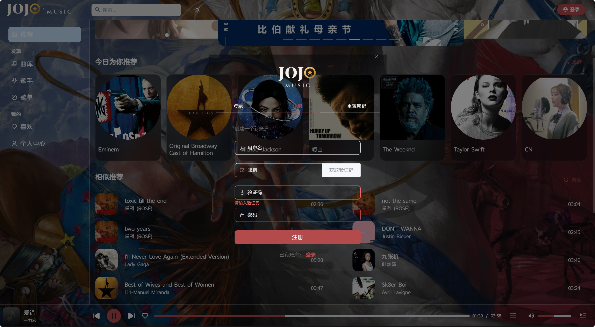
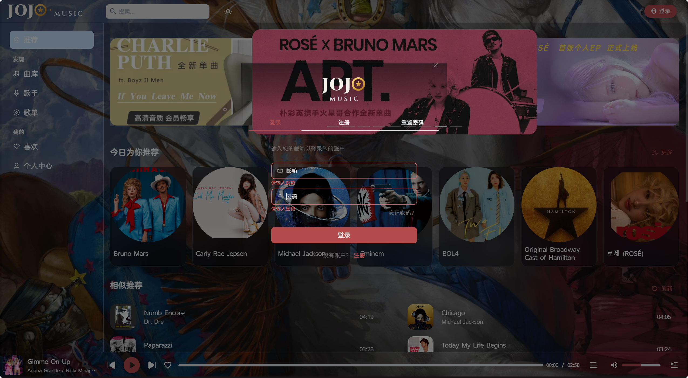
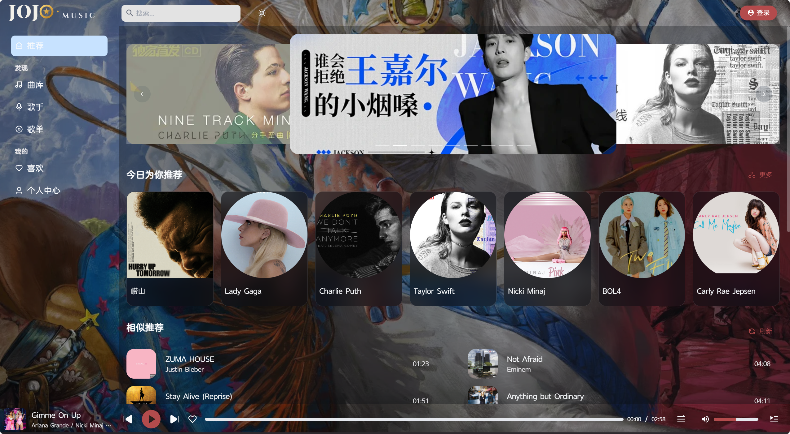
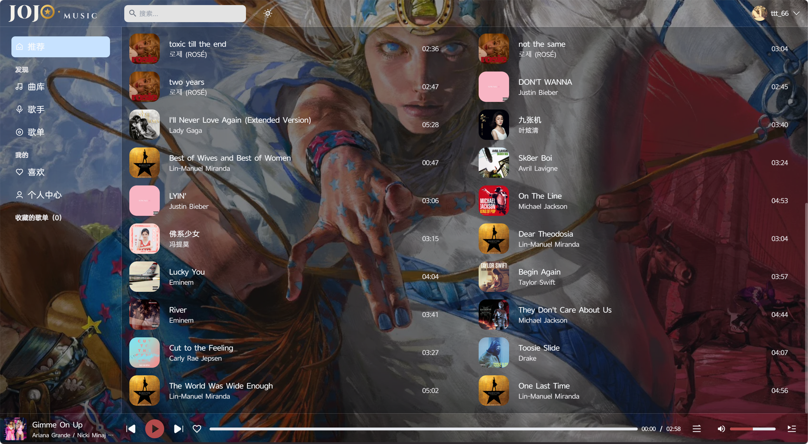

### 曲库浏览

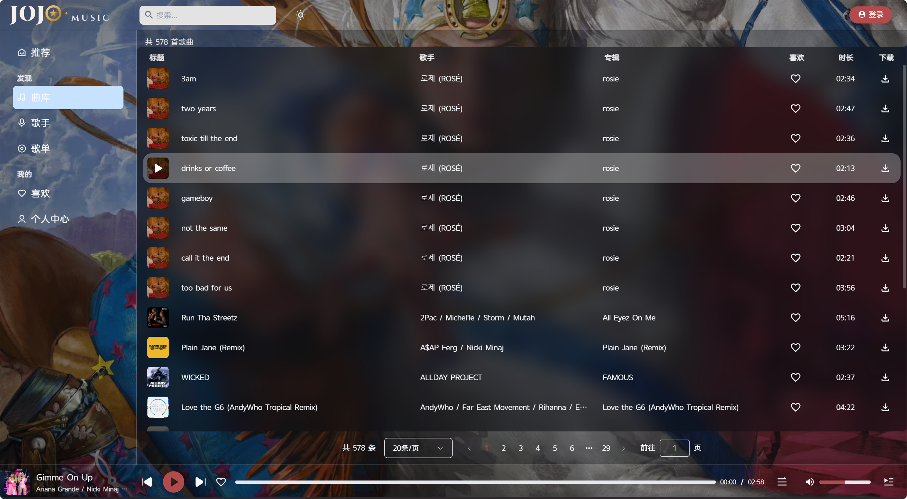
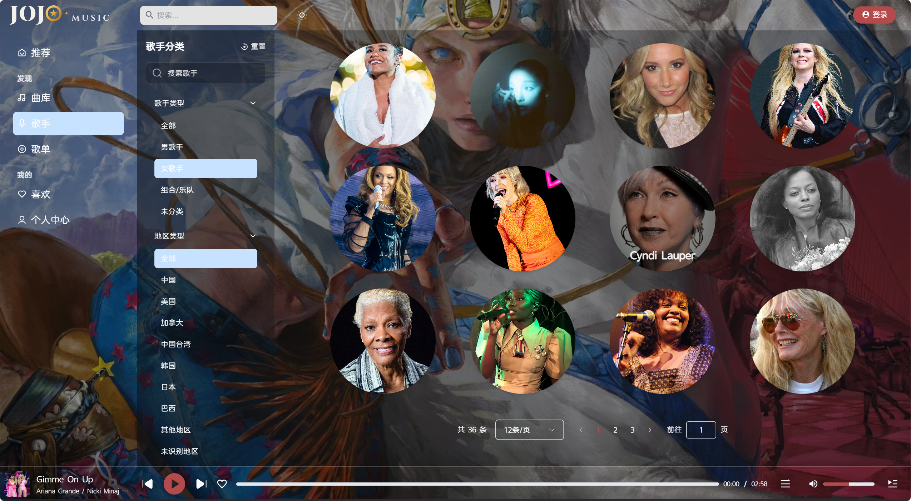
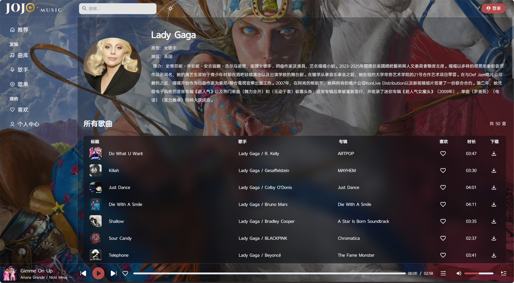
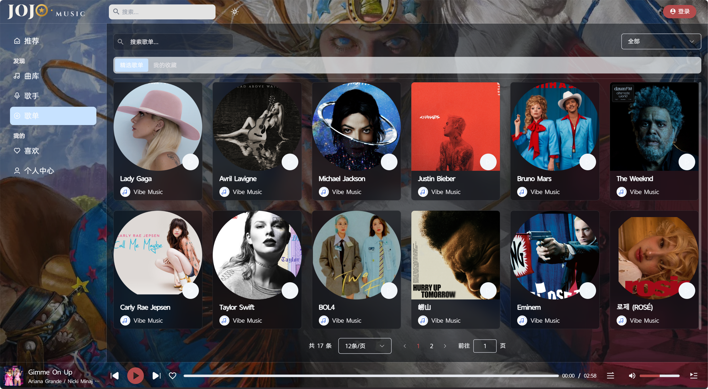
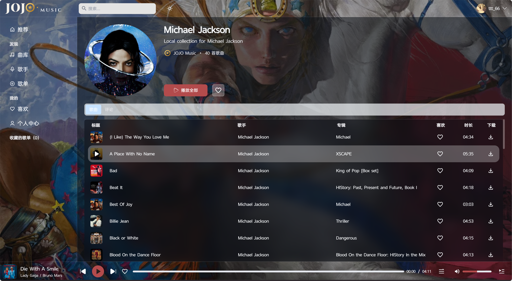
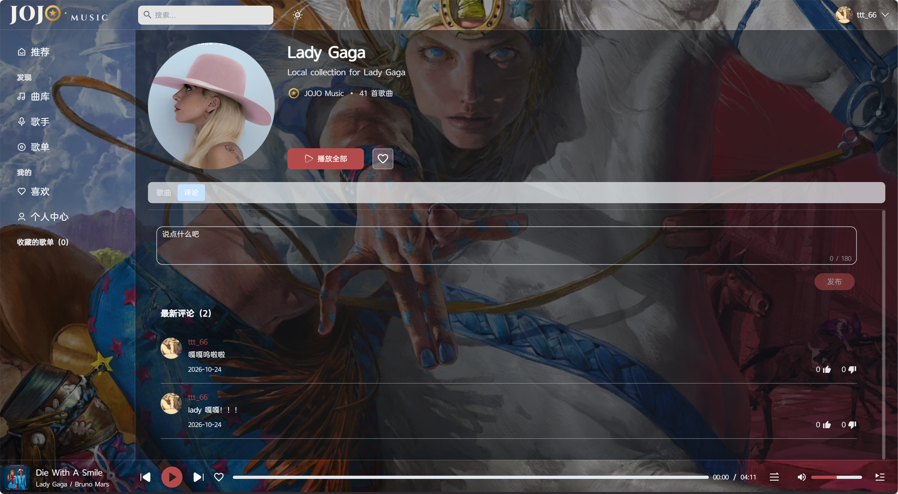

### 播放与个人

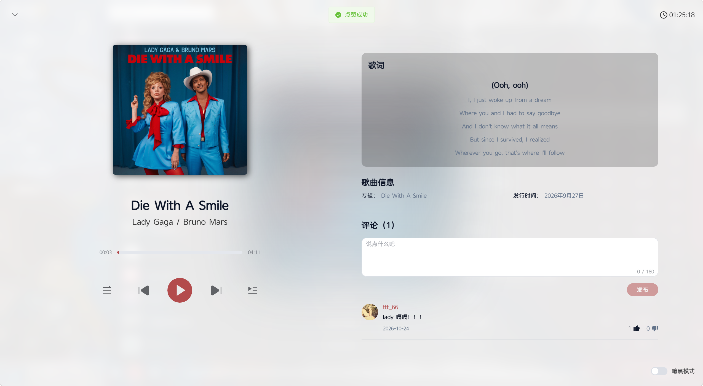
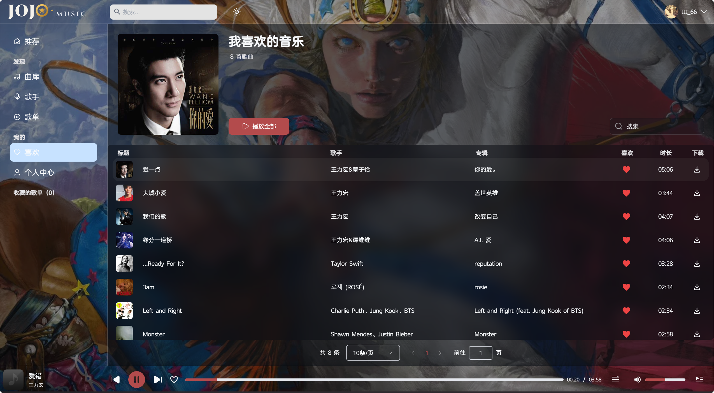
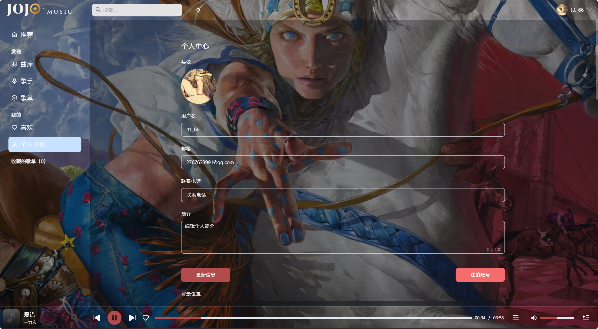

### 自定义背景（壁纸）

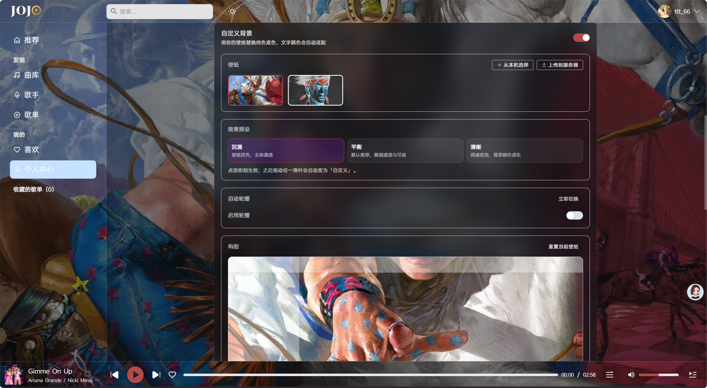

## 后端依赖

本项目依赖 JOJO MUSIC Server 提供 API 与数据支持。

- 后端仓库：https://github.com/timi669/jojo-music-server

## 版权与免责声明

本项目仅供学习、研究和个人开发实践使用。

- 请勿用于侵权、违法或商业用途
- 你必须确保内容来源、资源授权和部署环境合法合规
- 因使用本项目产生的后果由使用者自行承担

## 许可证

本项目遵循 MIT 许可证，详情请查看 [LICENSE](LICENSE)。

## 贡献

欢迎提交 Issue、Pull Request 和改进建议。
